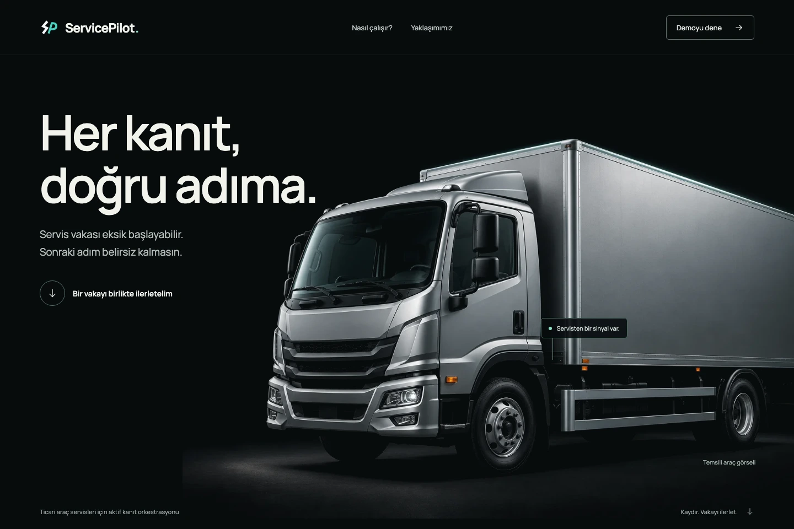
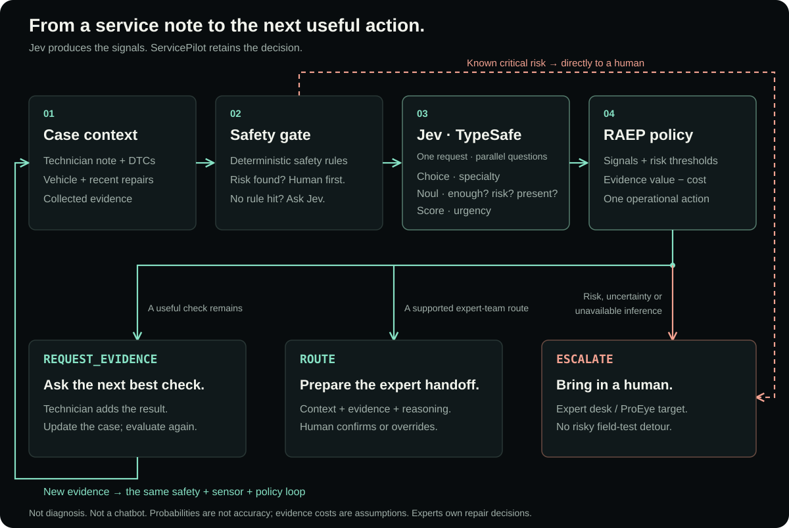
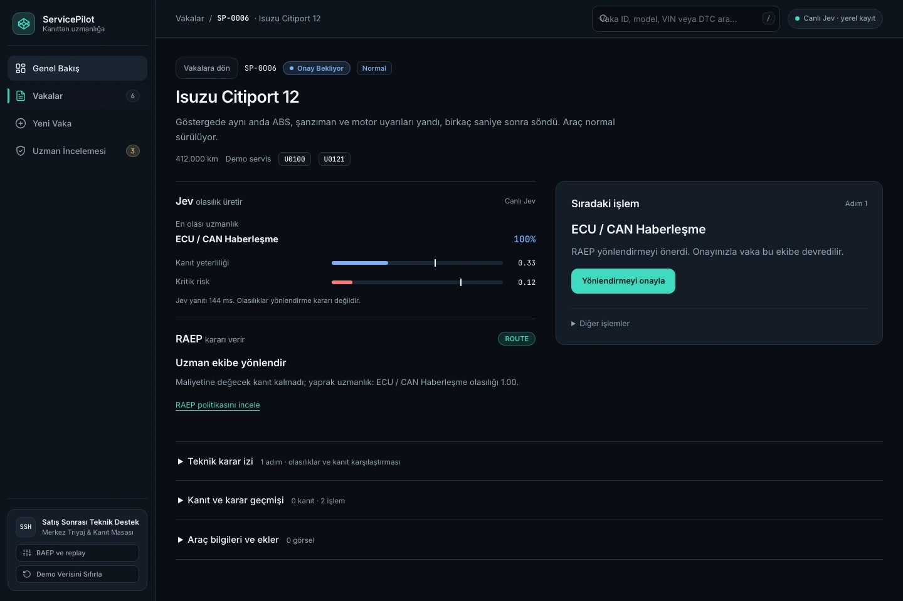

<p align="center">
  
</p>
<h1 align="center">ServicePilot</h1>
<p align="center"><b>The next best evidence. The right expert. Human control.</b></p>
<p align="center">
  <a href="https://alperkartkaya.github.io/ServicePilot/demo/"></a>
  <a href="https://alperkartkaya.github.io/ServicePilot/"></a>
  <a href="https://docs.typesafe.ai/introduction"></a>
  
  
</p>
<p align="center">
  <a href="https://alperkartkaya.github.io/ServicePilot/">Explore the story</a> ·
  <a href="https://alperkartkaya.github.io/ServicePilot/demo/">Try the demo</a> ·
  <a href="specs/ARCHITECTURE.md">Under the hood</a>
</p>

ServicePilot helps commercial-vehicle service teams turn incomplete cases into **useful evidence requests and prepared expert handoffs**. It is a decision layer, not a fault-diagnosis bot.

<a href="https://alperkartkaya.github.io/ServicePilot/">
  
</a>

## Jev measures. RAEP decides.

[Jev](https://docs.typesafe.ai/introduction), TypeSafe's System One model, is our **semantic sensor**. Each normal decision step sends the case context and typed questions in **one parallel API request**, rather than asking a chatbot for a diagnosis.

| Jev primitive | What ServicePilot asks |
|---|---|
| `Choice` | Which technical specialty? → `route` probabilities |
| `Noul` | Enough evidence? Critical risk? Check already present? → `sufficient`, `critical`, `has_*` |
| `Score` | How urgent? → `priority` |

**RAEP — our Risk-Aware Evidence Policy — makes the operational decision.** It combines Jev's signals with risk thresholds and the expected value/cost of the next evidence. The R&D focus is **active evidence collection, uncertainty reduction and risk-controlled routing** — not a model wrapper.

## One case. A complete decision loop.



Known critical risk skips Jev. Critical signals, unresolved uncertainty or unavailable inference can also lead to a human expert. Diagnosis and repair remain the expert's job.

## See the decision, not just an answer

<a href="https://alperkartkaya.github.io/ServicePilot/demo/">
  
</a>

*Real UI, synthetic case, live Jev response. The displayed probability and latency are one example, not accuracy or speed benchmarks. [Capture details](docs/assets/README.md).*

**Try it:** open the demo → choose **Kanıt döngüsünü dene** → add evidence if requested → inspect the decision trace → confirm or override the handoff. Live results may take a different path from the fixture story.

The landing uses **fixture signals**. The hosted demo uses **live Jev** for new cases/evidence, without a login or access code; initial records and replay stay synthetic. Keys remain server-side, records stay in your browser, and public use consumes the owner's Jev quota. **Do not enter real customer data.**

## Run locally

Requires Python 3.11+ and [uv](https://docs.astral.sh/uv/).

```sh
uv sync
# Add TYPESAFE_API_KEY=... to .env for live inference; never commit it.
uv run uvicorn app.main:app --reload
```

Open [the landing](http://localhost:8000/), [the demo](http://localhost:8000/demo/) or [the API docs](http://localhost:8000/docs). No frontend build step. Local API mode uses SQLite; the public demo uses browser-local storage.

<details>
<summary>Tests, architecture & operator guides</summary>

```sh
uv run pytest -q
node --test tests/test_frontend.mjs tests/test_landing.mjs tests/test_worker.mjs
```

[Requirements](specs/REQUIREMENTS.md) · [Architecture](specs/ARCHITECTURE.md) · [Worker & secrets](docs/WORKER.md) · [Landing & browser checks](docs/LANDING.md) · [Validation evidence](docs/VALIDATION.md) · [Reference coding](docs/REFERENCE_CODING.md)

</details>

**Scope:** today's MVP evaluates text/JSON; photo previews are not image analysis. Multimodal evidence and an Anadolu Isuzu PoC are product goals, not shipped analysis or a completed partnership. Scenario costs are assumptions; no field savings or accuracy claim.
