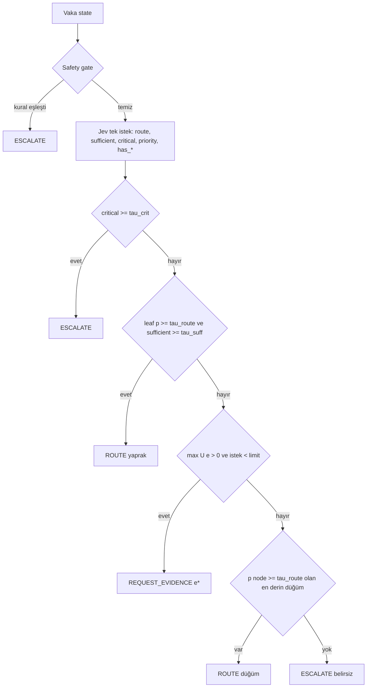

# Architecture — ServicePilot MVP

## 1. Bileşenler

```mermaid
flowchart TD
  UI["static/demo/ + app.js + style.css<br/>Tarayıcı UI · build yok"] -->|fetch /api/*| API["app/main.py<br/>FastAPI · vaka yaşam döngüsü · replay"]
  API --> STORE["app/store.py<br/>SQLite · vakalar + ayarlar"]
  API --> JEV["app/jev.py<br/>Jev / TypeSafe · semantic sensor"]
  API --> RAEP["app/raep.py<br/>RAEP · saf karar fonksiyonları"]
  CATALOG["app/catalog.py<br/>Taksonomi · kanıt · safety · ayarlar"] --> JEV
  CATALOG --> RAEP
  SCENARIOS["app/scenarios.py<br/>Demo / replay senaryoları"] --> API
```

Bu diyagram yerel FastAPI yoludur; Pages + Worker yolu belgenin sonunda açıklanır.

Jev'i başka bir typed-decision modeliyle değiştirmek = `app/jev.py`'yi değiştirmek. RAEP yalnız `signals` sözlüğünü görür (bkz. ADR-3).

## 2. Karar akışı (bir adım)

## 3. Jev soru tasarımı (FR-3)

State (JSON): `vehicle`, `technician_note`, `dtc_codes`, `recent_repairs`, `collected_evidence[]`.

| Soru | Tip | Anlam |
|---|---|---|
| `route` | choice | Yaprak uzmanlıklar arasından sorumlu ekip; kriterler katalog açıklamaları |
| `sufficient` | noul | Toplanan bilgi, ek ölçüm/foto olmadan sorumlu uzmanlığı belirlemeye yeter mi? |
| `critical` | noul | Acil güvenlik riski (yangın/duman, fren/direksiyon kaybı, HV maruziyeti, araç sürülmemeli) |
| `priority` | score | 4 seviye: rutin → yolda kaldı/güvenlik |
| `has_<evidence>` | noul | Vaka bu kanıtın **sonucunu** zaten içeriyor mu? (serbest metinde gizli kanıtı tespit) |

Hepsi aynı state üzerinde paralel, tek round-trip. Gecikme canlı adımda ölçülür; demo gecikmeleri performans kanıtı değildir.

## 4. RAEP algoritması

Notasyon: yaprak olasılıkları `p_l` (Jev `route`), `p_crit` (Jev `critical`).

**Düğüm olasılığı, mevcut hata, kayıp ağırlığı ve risk:**

Kritik vakada yanlış otomasyon olağan misroute'tan pahalıdır.

**Kanıt modeli (partition + reliability):** Her kanıt `e`, bir yaprak kümesi `𝒮_e` hakkında bilgi verir ve güvenilirliği `ρ_e`'dir. Kanıt toplandığında `ρ_e` olasılıkla bilgilendiricidir: gerçek yaprağın `𝒮_e` içinde olup olmadığı öğrenilir, içindeyse yaprak tam belirlenir. `1 − ρ_e` olasılıkla hiçbir şey değişmez.

Beklenen sonraki hata:

Küme dışında yaprak yoksa toplam ve maksimum `0` alınır (`app/raep.py: expected_err`). `𝒮_e` yaprak kümesidir; aşağıdaki `S_e` ise sayısal güvenlik/operasyon maliyetidir.

**Maliyet ve net fayda:**

`T`: dakika, `E`: efor 1–5, `S`: güvenlik/operasyon 0–5. Katalog değerleri **uzman varsayımıdır**.

En yüksek `U > 0` kanıt istenir. Hiçbiri pozitif değilse hiyerarşik fallback (FR-7).

**Aday filtreleri:** toplanmış kanıt; `has_<id> ≥ 0.7`; `requires_ev` ve araç elektrikli değil; `dtc_scan` ve vakada DTC var.

Görseller [Typst kaynağından](../docs/assets/raep-formulas.typ) üretilir; [yeniden üretim komutları](../docs/assets/README.md#regenerate). Politika matematiği değişmemiştir.

## 5. Baseline'lar (replay, FR-13)

| Baseline | Tanım |
|---|---|
| B — sabit checklist | Jev tek-shot'un tahmin ettiği üst grubun tüm uygulanabilir kanıtları istenir; maliyet = toplam `C(e)`; tüm cevaplarla Jev `argmax` route (eskalasyon yok) |
| C — Jev tek-shot | İlk adımda `argmax p_l`, kanıt yok, eskalasyon yok |
| ServicePilot | Jev + RAEP döngüsü |

Doğruluk: tam (yaprak eşit) ve hiyerarşik (hedef, beklenen yaprağın atası). Kritik senaryoda doğru sonuç = `ESCALATE`.

## 6. Kalıcılık

SQLite `data/servicepilot.db`: `cases(id TEXT PK, data TEXT JSON, created_at)`, `kv(key PK, value JSON)` (ayarlar). ORM yok.

## 7. Operasyonel karar izi [FR-18, FR-21]

Vaka ekranı `Jev sinyalleri → RAEP kararı → tek sıradaki işlem` ayrımını görünür tutar. Tam hesaplar, ham sinyaller, geçmiş ve araç ekleri açılır bölümlerdedir. Her karar adımı `settings` snapshot’ını ve `signal_source` bilgisini taşır. Kaynağı olmayan eski adım `unknown` kalır; `is_demo` tek başına sonraki adımların temsili olduğunu kanıtlamaz. Yeniden hesaplama kaynak/snapshot geçmişini silmez ve yeni Jev çağrısı yapmaz. Politika matematiği değişmemiştir.

## GitHub Pages + Worker sensörü [FR-22, ADR-11]
`Pages vaka metni → origin + boyut/şema + yaklaşık oran sınırı → sabit Jev soruları → typed sinyaller → tarayıcı RAEP → yerel kayıt/insan işlemi`. Bu yol FastAPI veya SQLite'ı Worker'a taşımaz. Python `app/raep.py` ve mevcut JS politika matematiği değişmez. Worker sözleşmesi `app/jev.py` + `app/catalog.py` kaynaklarından `uv run python -m worker.export_contract` ile üretilir; drift testi vardır. Güvenlik kapısı hem istemcide hem sensörde modelden önce çalışır. Kota hatasında kanıt geçici kopyası kaydedilmez. Ziyaretçi kimliği/kodu aranmaz; Pages otomatik canlıdır (ADR-12). Sağlayıcı hatası `unavailable` ile eskale edilir; fixture'a sessiz dönüş yoktur. Yeniden hesaplama kaynak etiketini ve geçmişi korur.
